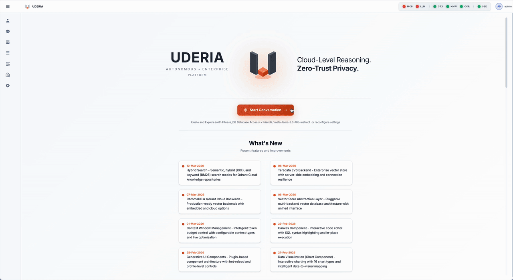
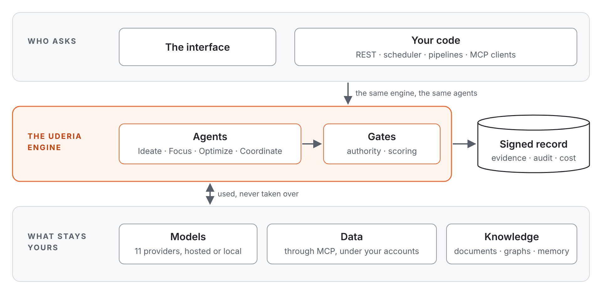

# Uderia

**A framework for trusted data agents.**

*Cloud-Level Reasoning. Zero-Trust Privacy. Token-Level Efficiency.*

[](LICENSE) [](docs/guides/INSTALL.md)

Uderia is a framework for building efficient data agents that run on any model, over any data source, inside your own walls, and prove every action. Agents built on it answer questions from your data and your documents, act on your systems only within the authority they were given, and leave a signed record of what they did. Its runtime implementation, **the Uderia platform** — a server, an interface and a REST API — makes them work out of the box.



---

## Why it exists

Connecting a capable model to a database is no longer the hard part. The hard parts are the ones an organisation has to answer for:

1. **An answer that stays within the evidence** — what the data and the documents actually say.
2. **An action that stays within the mandate** — what the agent was allowed to do, and nothing more.
3. **A record someone else can check** — after the fact, without having to trust the system that made it.
4. **A cost that belongs to someone** — per agent, per turn, read from the provider, not estimated.
5. **A path to production** — from the first exploratory question to the job that runs every night, without a rebuild.

Uderia is built around these five. The sections below show how, and link to where each claim can be checked.

## Where it is heading: the autonomous enterprise

The ambition behind Uderia is an enterprise where routine questions and decisions are delegated to agents, and people spend their attention where judgement is needed. Autonomy there is earned, not switched on: each agent is given as much as its evidence supports, and no more. Its gates move from observing to enforcing, its changes from parked for review to approved, and its authority always fails closed ([the maturity ladder](docs/manuals/AGENT_TRUST_AND_ASSURANCE.md#31-the-operating-posture--a-maturity-ladder)). Some acts stay with people by design: signing an agent, entering credentials, approving a change.

Today the path already covers the whole range, from assisted to self-operating: [coordinators](docs/Architecture/COORDINATOR_ARCHITECTURE.md) delegate to specialist agents, [scheduled runs](docs/Architecture/SCHEDULER_ARCHITECTURE.md) work unattended and [stop to ask](docs/Architecture/NEEDS_INPUT_ARCHITECTURE.md) when unsure, [signed actions](docs/capabilities/OBDA.md) change the business, and agents operate Uderia itself through the [Platform component](docs/manuals/PLATFORM_ROLES.md), within the roles they are granted.

## How it works

An agent in Uderia is a configuration, not a program: a model, the data sources it may reach, the knowledge and graphs it reads, and the trust posture it runs under. One engine runs every agent, whether the request comes from the interface or from code.

[](images/how-it-works.svg)

Agents come in four classes. Each is a different way of working, and you can move between them in one conversation:

| Class | Bootstrap agent | Built for |
|---|---|---|
| **Ideate** | `@IDEAT` | Open reasoning and drafting, optionally with tools |
| **Focus** | `@FOCUS` | Answers grounded in your documents, with their sources |
| **Optimize** | `@OPTIM` | Planned work on data: a strategic plan, tactical steps, self-correction, and plans that worked replayed for similar questions |
| **Coordinate** | `@COORD` | A team of agents: the coordinator routes the question to specialists, each with its own data, model and trust posture, and combines their answers |

Efficiency is designed in, not tuned afterwards. An Optimize agent writes its plan once, runs the steps whose arguments are already known without a model call, replays a plan that worked when a similar question returns, and carries earlier results forward instead of fetching them again. Planning and execution can run on different models, and every turn's tokens and cost are read from the provider's own response, so efficiency is a number you can see per agent and per turn.

[Profile Classes →](docs/capabilities/PROFILE_CLASSES.md) · [Fusion Optimizer →](docs/capabilities/FUSION_OPTIMIZER.md) · [Proof pack P4 →](docs/proof-packs/P4_FINOPS.md) · [System Overview →](docs/Architecture/SYSTEM_OVERVIEW.md)

## From ideation to operationalization

What a team explores is what runs in production. The path has two halves:

- **How you work.** Ideate, Focus, Optimize and Coordinate in one conversation, switched per question with an `@TAG`. Exploring an idea and running a governed, multi-agent query on live data happen in the same place.
- **How it leaves the interface.** The interface is one client of a REST-driven engine, not the place the work lives. Every agent you configure and every question you ask runs unchanged from code: over the REST API, as a scheduled task, inside a pipeline, as an MCP tool for other agents, or as an agent pack that recreates the whole setup in another deployment.

The question you refined in a conversation, sent from code with the agent that answered it:

```bash
curl -X POST http://localhost:5050/api/v1/sessions/$SESSION_ID/query \
  -H "Authorization: Bearer $UDERIA_TOKEN" \
  -H "Content-Type: application/json" \
  -d '{"prompt": "Which regions missed plan last quarter?", "profile_id": "<the agent id>"}'
```

It runs through the same engine and the same agent, and the task returns the same event stream the interface shows. [Operationalization →](docs/guides/USER_GUIDE.md#operationalization) · [REST API →](docs/RestAPI/restAPI.md) · [Operations catalog →](docs/RestAPI/PLATFORM_OPERATIONS.md)

## Trust you can check

Trust in Uderia is earned, shown and carried, never asserted. It is applied at four moments:

| When | What Uderia does | Read more |
|---|---|---|
| **Before an answer reaches you** | The grounding gate checks the answer against the data and knowledge the turn actually had; the honesty gate checks that what the answer claims about its own evidence is true; guardrails screen what goes in and what comes out for personal data, toxicity and prompt injection. Per agent, each gate observes, annotates, or enforces — optionally keeping the withheld original for review. | [Answer gates](docs/capabilities/SECURITY_AND_TRUST.md#-answer-gates--between-the-draft-and-the-user) |
| **While an agent acts** | Its authority over tools, data and writes is enforced where the call is made and fails closed. Governed data is read through signed data products; the business is changed only through signed actions that are prepared, confirmed and recorded. | [Authorization](docs/capabilities/SECURITY_AND_TRUST.md#-authorization--access-control) · [The ontology planes](docs/capabilities/COMPONENTS.md#obda-read--obda-model--obda-act--the-ontology-planes) |
| **After every turn** | The turn is scored by a profile-class-aware scorer suite, sealed with an Ed25519 signature over its execution chain, and recorded with the evidence of every part it used. | [Evidence](docs/capabilities/EVIDENCE.md) · [Proof pack A6](docs/proof-packs/A6_EVAL_OBSERVABILITY.md) |
| **Over the agent's life** | Its configuration, knowledge, graphs and skills are each signed; its Trust Circle shows where it stands and which act is owed; its trust posture travels with it and is checked again on arrival. | [Trust Membrane](docs/capabilities/TRUST_MEMBRANE.md) · [Operator runbook](docs/manuals/AGENT_TRUST_AND_ASSURANCE.md) |

Controls are mapped to ISO 27001, SOC 2, the EU AI Act and the NIST AI RMF in the [operator runbook](docs/manuals/AGENT_TRUST_AND_ASSURANCE.md).

**Check a signed answer yourself, without installing Uderia** — a captured attestation and the public key ship in the repository:

```bash
cd docs/proof-packs/samples && pip install cryptography && python verify_attestation.py
# RESULT: ATTESTATION VALID — verdict is cryptographically bound to the trajectory
```

## Seven principles

| Principle | In one line |
|---|---|
| **Actionable** | What you shape interactively runs as code: the question from a script or a scheduler, the agent's setup through the API. |
| **Transparent and trusted** | Every step shown and recorded; every answer gated, scored and signed; every agent's parts signed and its authority failing closed. |
| **Efficient** | The plan written once, known steps run without a model call, proven plans replayed, every prompt held within a token budget. |
| **Sovereignty** | Model, embeddings, vector store, graph store, data source and state each have a local option; fully offline is a configuration. |
| **Financial governance** | Every token read from the provider, priced, and attributed to the agent, the turn and the session, with quotas per user. |
| **Collaborative** | Repositories, agent packs, skills, extensions and graphs shared through the marketplace; subscribers stay current and trust travels along. |
| **Open and extensible** | Source-available code and open standards at every boundary; sixteen documented extension points; what the public core carries and what the enterprise package adds, stated plainly. |

What each principle means, the outcomes it serves and where each can be checked: [Value Proposition](docs/value/VALUE_PROPOSITION.md#seven-principles).

## Built to be built on

Uderia ships with 19 builtin components — sixteen in the public core (the knowledge graph, memory, compute, charts, the database navigator, files, the scheduler, flows, dashboards, the canvas, the platform tool, explain plan and more), three in the enterprise package (the OBDA planes: READ, MODEL and ACT; see [License](#license)). Everything else is added at sixteen extension points, each through a documented contract, never by forking the code:

| Area | Extension points |
|---|---|
| What an agent can do | [Components, including your own](docs/Architecture/COMPONENT_ARCHITECTURE.md#third-party-components) · [Connectors](docs/Architecture/CONNECTOR_ARCHITECTURE.md) · [Skills](docs/Architecture/SKILL_ARCHITECTURE.md) · [Extensions](docs/Architecture/EXTENSION_ARCHITECTURE.md) |
| What an agent knows | [Repository templates](docs/RAG_Templates/README.md) · [Knowledge sources](docs/Architecture/KNOWLEDGE_RETRIEVAL_ARCHITECTURE.md) · [Knowledge-graph constructors](docs/Architecture/ONTOLOGY_ARCHITECTURE.md#part-v--extension-contracts-how-to-add-a-participant) · [Context-window modules](docs/Architecture/CONTEXT_WINDOW_ARCHITECTURE.md) |
| How it runs | [Execution engines](docs/Architecture/ENGINE_MODULARIZATION_ARCHITECTURE.md#adding-a-new-engine) · [Model providers](docs/Architecture/LLM_PROVIDER_ARCHITECTURE.md#13-adding-a-provider--checklist) · [Vector and graph stores](docs/Architecture/VECTOR_STORE_ABSTRACTION_ARCHITECTURE.md) |
| What it reaches | Any MCP server, with custom objects (`deploy/mcp/README.md`) for the tools a server lacks |
| How it is trusted | [Assurance modules](docs/manuals/BUILDING_ASSURANCE_MODULES.md), signed before they may bind |
| How it travels and integrates | [Agent packs](docs/capabilities/MARKETPLACE.md#agent-packs-portable-ai-teams) · [Branding](docs/Architecture/BRANDING_ARCHITECTURE.md) · [REST API and operations catalog](docs/RestAPI/PLATFORM_OPERATIONS.md) · [Uderia as an MCP server](docs/Architecture/MCP_SERVER_ARCHITECTURE.md) |

The full list, with what each point adds: [Value Proposition: what the framework is](docs/value/VALUE_PROPOSITION.md#what-the-framework-is).

## What Uderia is not

- **Not a model.** It runs the model you choose, hosted or local, and can use different models for planning and execution.
- **Not a data store.** Your data stays in your systems. Agents reach it through MCP servers under the accounts you grant, and those accounts' rights remain the boundary.
- **Not a replacement for your governance.** Identity, database roles and policies stay where they are governed today; Uderia adds each agent's authority on top, and records what it did.

---

## Quick Start

Python 3.12, a running MCP server and an API key for one supported LLM provider (or a local Ollama / MLX install) are the prerequisites. The full walk-through, including the bootstrap configuration and the first-login checklist, is the [Installation and Setup Guide](docs/guides/INSTALL.md).

**Minimum system requirements** (one server, a handful of users; the right-hand column is the maintainer's reference deployment):

| | Minimum | Reference deployment |
|---|---|---|
| Processor | 2 cores, x86_64 or Apple Silicon; no GPU | 4 cores, x86_64 |
| Memory | 4 GB available to the server process | 6 GB container limit; about 1.5 GB idle, 2.5 GB in steady use |
| Disk | 5 GB: the Python environment (about 2.7 GB), the embedding model (about 90 MB), the databases | grows with sessions, knowledge repositories and the schema backups |
| Software | Python 3.12, or Docker Engine with Compose v2 | the `python:3.12-slim` image |
| Network | outbound HTTPS to the LLM provider and, once, to Hugging Face for the embedding model; a route to the MCP server; port 5050 inbound | |
| Browser | a current Chrome, Edge, Firefox or Safari | |

The default embedding model (`all-MiniLM-L6-v2`) runs on the CPU. A local model server (Ollama, MLX) needs its own memory on top; MLX runs on Apple Silicon only. Details and the optional external backends: [System requirements](docs/guides/INSTALL.md#system-requirements).

**First start.** The server serves as soon as its database is ready, then does two things in the background and says so in the log: it loads the embedding model (downloaded once from Hugging Face, about 90 MB; a few seconds from the cache afterwards; the header's knowledge lane reads Connecting until then), and it installs the bundled **Uderia Expert** agent (the @UDERIA documentation assistant, shipped with its vectors already computed, about four seconds) for the admin account, once. Nothing is embedded on your machine at start; an existing or removed Uderia Expert is never touched. Details: [First start](docs/guides/INSTALL.md#first-start).

```bash
git clone https://github.com/rgeissen/uderia-core.git
cd uderia-core
python3.12 -m venv venv && source venv/bin/activate
pip install -r requirements.txt
pip install -e .

# SECRET_KEY is required; the server refuses to start without it
python -c "import secrets; key=secrets.token_urlsafe(32); open('.env', 'w').write(f'SECRET_KEY={key}\n'); print('✓ Created .env with SECRET_KEY')"
# TDA_ENCRYPTION_KEY encrypts stored API keys; set it before the first start
python -c "import secrets; open('.env', 'a').write(f'TDA_ENCRYPTION_KEY={secrets.token_urlsafe(48)}\n'); print('✓ Added TDA_ENCRYPTION_KEY')"

python -m trusted_data_agent.main
```

Open `http://localhost:5050`, sign in as `admin` / `admin`, and change the password immediately in the **Administration** panel. For a container, see [Docker Deployment](docs/guides/DOCKER.md).

**Try it without a database of your own.** A new installation comes with one MCP server already configured, **Uderia demo — read-only (fitness_db)**, a public endpoint run by the author over a small sample schema (customers, sales, products, service tickets). Add an LLM key, and you can ask questions straight away. It is a shared demo: read-only, sample data only, rate- and time-limited, and it may be reset or unavailable at any time. Never connect your own data to it. To use your own database, add your own MCP server under **Anatomy → MCP Servers**.

---

## Documentation

| You want to | Start with |
|---|---|
| Understand why it matters | [Value Proposition](docs/value/VALUE_PROPOSITION.md) · framings: the framework (`docs/value/POSITIONING_FRAMEWORK.md`) · Uderia on Teradata (`docs/value/POSITIONING_TERADATA.md`) |
| See everything it does | [Capabilities](docs/capabilities/README.md) · [Key Features](docs/capabilities/KEY_FEATURES.md) |
| Install and run it | [Installation](docs/guides/INSTALL.md) · [Docker](docs/guides/DOCKER.md) |
| Use it day to day | [User Guide](docs/guides/USER_GUIDE.md) · [Consumption Profiles](docs/guides/CONSUMPTION_PROFILES.md) |
| Run it from code | [Operationalization](docs/guides/USER_GUIDE.md#operationalization) · [REST API](docs/RestAPI/restAPI.md) · [Operations catalog](docs/RestAPI/PLATFORM_OPERATIONS.md) |
| Operate trust and assurance | [Agent Trust & Assurance runbook](docs/manuals/AGENT_TRUST_AND_ASSURANCE.md) · [Security & Trust](docs/capabilities/SECURITY_AND_TRUST.md) |
| Check the claims | [Proof packs](docs/proof-packs/README.md) |
| Understand how it is built | [System Overview](docs/Architecture/SYSTEM_OVERVIEW.md) · [Documentation index](docs/README.md) · [Architecture documents](docs/README.md#-architecture-documentation) |

The documentation is organised in three layers — value (why it matters), capabilities (what it does) and technology (how it is built and operated) — so each can change without disturbing the others. What changed recently, in user terms: [What's New](docs/WHATS_NEW.md). The engineering change history: [Changelog](docs/CHANGELOG.md).

---

## License

Uderia is published from one source as two distributions. What each carries, side by side:

<!-- distributions-table-begin -->
| Area | Public core — `uderia-core`, FSL-1.1-ALv2 | Enterprise package — `uderia-enterprise`, under the Uderia Enterprise Licence, adds |
|---|---|---|
| **Agents and planning** | The four agent classes (Ideate, Focus, Optimize, Coordinate), the planner and its rewrite passes, FASTPATH, the orchestrators, the governed tool surface | — |
| **Trust** | The grounding and honesty gates, Ed25519 signatures, attestation, the evidence per result, the assurance-module plane, the Trust Circle, evaluation and scorers | The acts of signing: sign-off of an artifact, attestation of a deployment, revocation (the core shows trust and verifies signatures; it does not sign) |
| **Components** | Context Window, Memory, Needs Input, Tool Finder, Skill Library, Compute, Chart, Knowledge Graph, Database Navigator, Files, Scheduler, Flow, Dashboard, Canvas, Platform, Explain Plan | OBDA-READ, OBDA-MODEL, OBDA-ACT |
| **Knowledge** | Planner and knowledge repositories, repository templates, CDC sync, the knowledge graph on SQLite + NetworkX and the Neo4j graph-store backend, the ChromaDB, Qdrant and Teradata vector-store backends, the database-context, declared-model and ANDP constructors | — |
| **Storage** | The file and Postgres session backends; the local, S3, Azure Blob and Google Cloud Storage file-store backends | External key managers (AWS KMS, Azure Key Vault, Google Cloud KMS, Vault) |
| **Identity** | Passwords, JWT, access tokens | OIDC and SAML 2.0 federation, Google and GitHub sign-in |
| **Data sources** | Any MCP server with custom objects; the PostgreSQL, MySQL, SQLite, DuckDB, MongoDB and JDBC connectors; the Teradata dialect, catalog provider, deployment backend, SQL pattern library and skills | — |
| **Connectors** | The platform connectors (browser, files, shell, web search); the Google, Microsoft 365 (Outlook, Teams, SharePoint) and Slack account connectors | — |
| **Prompts** | The fifteen system prompts, plain text, versioned, release-synced | The editor: per-user overrides with history |
| **Faces** | The REST API and SSE, Uderia as an MCP server, the operations catalog | — |
| **Marketplace** | Agent packs, repositories, skills, extensions, graphs, assurance modules; export and import; the @UDERIA pack | — |
| **Branding** | Uderia | White-label identities resolved by host |
| **Licence** | None needed | A signed Enterprise or Partner licence activates the package |

<!-- distributions-table-end -->

* **The public core** ([uderia-core](https://github.com/rgeissen/uderia-core)) is **Fair Source**, licensed under the **Functional Source License 1.1 with the Apache 2.0 future licence (FSL-1.1-ALv2)**. It is the framework with its runtime: the four agent classes and the planner, the trust model (the grounding and honesty gates, signatures, attestation, the evidence per result), the component and skill systems, the local vector, graph, session and file stores, the REST and MCP faces, and the system prompts in plain text. Use it, change it and redistribute it for any purpose except a *Competing Use* — offering it, or something substantially similar, to others as a commercial product or service. Running it inside your organisation, building your own agents on it, teaching and research with it, and professional services for its users are all permitted. Each release becomes open source under the Apache License 2.0 two years after it ships. The terms are in `LICENSE`.
* **The enterprise package** ([uderia-enterprise](https://github.com/rgeissen/uderia-enterprise)) is licensed under the **Uderia Enterprise Licence**, whose terms govern its intellectual property and distribution. It installs beside the core and adds the three OBDA planes (OBDA-READ, OBDA-MODEL and OBDA-ACT), identity federation (OIDC, SAML 2.0), external key managers, white-label branding, the system-prompt editor, and the acts of signing (sign-off, attestation, revocation). A licence key may name the parts of the package it entitles; a part it does not name is absent from the deployment, as it is from the core.

The copyright stays with the author. Contributions to the public core are accepted under a contributor licence agreement ([individual](legal/CLA-individual.md), [corporate](legal/CLA-corporate.md)), which is what keeps both distributions possible; how to contribute is in [CONTRIBUTING.md](CONTRIBUTING.md).

## Author & Contributions

* **Author/Initiator:** Rainer Geissendoerfer ([LinkedIn](https://www.linkedin.com/in/rainer-geissendoerfer/))

* **Source Code & Contributions:** the public core is Fair Source under the Functional Source License (FSL-1.1-ALv2), each release becoming Apache 2.0 open source after two years; issues and pull requests are welcome, under the contributor licence agreement described in [CONTRIBUTING.md](CONTRIBUTING.md).

* **Git Repository:** <https://github.com/rgeissen/uderia-core>
