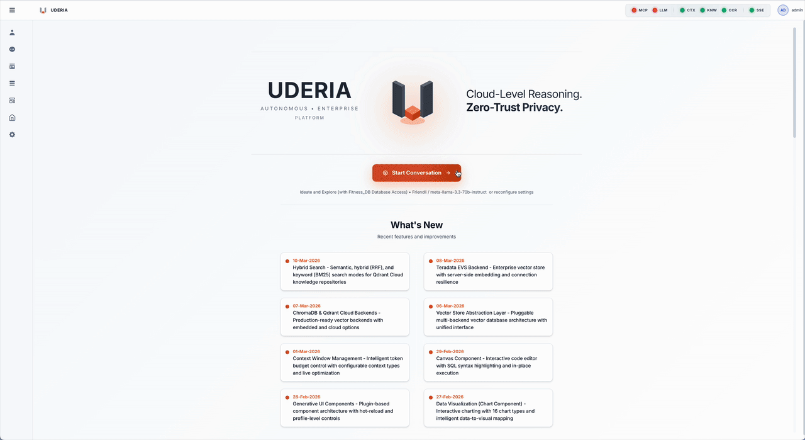

# Uderia — Value Proposition
### A framework for trusted data agents

Uderia is a framework for building efficient data agents that run on any model, over any data source, inside your own walls, and prove every action.

Each clause of that sentence is a fact you can check. "Efficient" is the planner's design: the plan is written once, steps whose arguments are already known run without a model call, a plan that worked is replayed for a similar question, and every turn's tokens and cost are read from the provider's own response ([Fusion Optimizer](../capabilities/FUSION_OPTIMIZER.md), [proof pack P4](../proof-packs/P4_FINOPS.md)). The models are the eleven providers the framework ships with, from hyperscaler APIs to a laptop running Ollama or MLX. The data sources are whatever an MCP server exposes. "Inside your own walls" is a configuration choice, not a promise: every layer has a fully local option. "Proves every action" is an Ed25519 signature over each turn's execution chain, verifiable offline by anyone with the public key.

This page is the neutral core of the value story. It says what the framework gives an organisation and where each claim is substantiated. How the same facts are told to a team deciding how to build its agents, and how they are told to a Teradata account, are two separate framings: Positioning: the framework (`docs/value/POSITIONING_FRAMEWORK.md`) and Positioning: Uderia on Teradata (`docs/value/POSITIONING_TERADATA.md`).

## Where it is heading: the autonomous enterprise

The ambition behind Uderia is an enterprise where routine questions and decisions are delegated to agents, and people spend their attention where judgement is needed. Autonomy there is earned, not switched on: each agent is given as much as its evidence supports, and no more. Its gates move from observing to enforcing, its changes from parked for review to approved, and its authority always fails closed ([the maturity ladder](../manuals/AGENT_TRUST_AND_ASSURANCE.md#31-the-operating-posture--a-maturity-ladder)). Some acts stay with people by design: signing an agent, entering credentials, approving a change.

Today the path already covers the whole range, from assisted to self-operating: [coordinators](../Architecture/COORDINATOR_ARCHITECTURE.md) delegate to specialist agents, [scheduled runs](../Architecture/SCHEDULER_ARCHITECTURE.md) work unattended and [stop to ask](../Architecture/NEEDS_INPUT_ARCHITECTURE.md) when unsure, [signed actions](../capabilities/OBDA.md) change the business, and agents operate Uderia itself through the [Platform component](../manuals/PLATFORM_ROLES.md), within the roles they are granted.

## From ideation to operationalization

The framework is built for one path: an idea becomes a governed agent that runs in production, without a hand-off and without a rebuild. The path has two halves.

| Half | What it means | What you can check |
|---|---|---|
| How you work | Four ways of working in one conversation: *Ideate* for open reasoning, *Focus* for answers grounded in your documents, *Optimize* for planned, tool-driven data work, *Coordinate* for several experts at once. You move between them per question, with a tag. | Every turn records the agent it ran on; the session lists every agent and model used. [Profile Classes](../capabilities/PROFILE_CLASSES.md) |
| How it leaves the interface | The interface is one client of a REST-driven engine, not the place the work lives. An agent set up interactively is created, changed and exported through the same API; a question that worked in a conversation runs unchanged from a script, a scheduler, a pipeline or another agent. | The same prompt with the same `profile_id` over REST runs through the same engine and agent and returns the same event stream; an agent pack recreates the setup in another deployment. [Operationalization](../guides/USER_GUIDE.md#operationalization) |

Together they mean that what was explored is what runs: the same agent, the same engine and the same trust posture, from the first question to the scheduled job.

## What the framework is

A framework is what you build on. Uderia has three parts. The first two are the framework itself; the third, the Uderia platform, is its runtime implementation, so the first two work out of the box.

| Part | What it is | Where it is described |
|---|---|---|
| The agent model | Four classes of agent (Ideate, Focus, Optimize, Coordinate), one execution engine per class, and the planner, gates and learning loop they share. | [Profile Classes](../capabilities/PROFILE_CLASSES.md) · [Engine modularization](../Architecture/ENGINE_MODULARIZATION_ARCHITECTURE.md) |
| The trust model | What makes an agent trustworthy and how that is shown: grounding, guardrail and honesty gates, scoring after every turn, signatures over agents and their parts, the evidence behind each answer, and the authority an agent may act with. | [Security & Trust](../capabilities/SECURITY_AND_TRUST.md) · [Trust Membrane](../capabilities/TRUST_MEMBRANE.md) · [Evidence](../capabilities/EVIDENCE.md) |
| The Uderia platform | The framework's runtime implementation — the server, interface and REST API: multi-user sign-in, sessions, cost tracking and the marketplace. A deployment is one running instance of it, with its own keys, data and configuration. | [System Overview](../Architecture/SYSTEM_OVERVIEW.md) · [Installation](../guides/INSTALL.md) |

The interface is one client of that engine, not the place the work lives. Agents, LLM configurations and data sources are created through the same `/api/v1` routes the interface calls, and every route describes itself in the [operations catalog](../RestAPI/PLATFORM_OPERATIONS.md). A question asked in a conversation runs on the same engine, with the same agent, when it is sent from code. So what a team shapes interactively becomes code without being rebuilt: the second half of [from ideation to operationalization](#from-ideation-to-operationalization).

What you build on it, each through a documented contract:

| Extension point | What you add | Contract |
|---|---|---|
| Components | A tool an agent can call, with its own panel; your own components install beside the builtin ones | [Component architecture](../Architecture/COMPONENT_ARCHITECTURE.md#third-party-components) |
| Skills | Knowledge injected into an agent's reasoning before it answers | [Skill architecture](../Architecture/SKILL_ARCHITECTURE.md) |
| Extensions | Processing that turns an answer into structured output | [Extension architecture](../Architecture/EXTENSION_ARCHITECTURE.md) |
| Repository templates | A pattern for building planner or knowledge repositories, registered and hot-reloaded | [RAG templates](../RAG_Templates/README.md) |
| Knowledge sources | A new kind of source a knowledge repository keeps in sync with | [Knowledge retrieval](../Architecture/KNOWLEDGE_RETRIEVAL_ARCHITECTURE.md) |
| Knowledge-graph constructors | A new way of building an ontology from a model, a catalog or a standard | [Ontology: extension contracts](../Architecture/ONTOLOGY_ARCHITECTURE.md#part-v--extension-contracts-how-to-add-a-participant) |
| Context-window modules | A source of context with its own token budget, installed and hot-reloaded | [Context window](../Architecture/CONTEXT_WINDOW_ARCHITECTURE.md) |
| Execution engines | A new way of running an agent class | [Engines: adding an engine](../Architecture/ENGINE_MODULARIZATION_ARCHITECTURE.md#adding-a-new-engine) |
| Model providers | A model provider behind the one LLM interface | [LLM providers: adding a provider](../Architecture/LLM_PROVIDER_ARCHITECTURE.md#13-adding-a-provider--checklist) |
| Vector and graph stores | A vector store or a graph store behind one interface each | [Vector stores](../Architecture/VECTOR_STORE_ABSTRACTION_ARCHITECTURE.md) · [Graph stores](../Architecture/KG_STORE_ABSTRACTION_ARCHITECTURE.md) |
| Data sources | Any MCP server; a tool the server lacks is added as a custom object, never by forking it | MCP endpoints and custom objects (`deploy/mcp/README.md`) |
| Connectors | Admin-governed capabilities such as files, browser, web and mail, over any transport | [Connector architecture](../Architecture/CONNECTOR_ARCHITECTURE.md) |
| Assurance modules | A third-party trust check that runs inside the assurance path, signed before it may bind | [Building assurance modules](../manuals/BUILDING_ASSURANCE_MODULES.md) |
| Agent packs | A team of agents with its knowledge, graphs and trust posture, moved between deployments as one signed artefact | [Marketplace: agent packs](../capabilities/MARKETPLACE.md#agent-packs-portable-ai-teams) |
| Branding | A brand of your own on a deployment, per hostname, with no fork | [Branding](../Architecture/BRANDING_ARCHITECTURE.md) |
| Integration | Every agent callable over REST and as an MCP tool; every route described for programs and agents alike | [MCP server](../Architecture/MCP_SERVER_ARCHITECTURE.md) · [Platform operations](../Architecture/PLATFORM_OPERATIONS_ARCHITECTURE.md) |

## Nine outcomes

| Outcome | What it means for you | What you can check | Described in |
|---|---|---|---|
| **Delegate, do not orchestrate** | A coordinating agent routes a question to specialist agents, each with its own data, model and trust posture, and combines their answers. You ask once. | The coordination trace names every expert consulted and its own cost, with no double counting. [Proof pack A4](../proof-packs/A4_MULTI_AGENT_ORCHESTRATION.md). | [Profile Classes: Coordinate](../capabilities/PROFILE_CLASSES.md#the-ifoc-philosophy-ideate--focus--optimize--coordinate) |
| **One conversation, four ways of working** | Ideate for open reasoning, Focus for answers grounded in your documents, Optimize for planned, tool-driven data work, Coordinate for several experts at once. Switch per question with a tag. | Every turn records the agent it ran on; the session lists every agent and model used. | [Profile Classes: the IFOC workflow](../capabilities/PROFILE_CLASSES.md) |
| **What you build interactively runs as code** | The interface and your code drive the same engine. An agent set up in the interface is created, changed and exported through the REST API; a question that worked in a conversation runs unchanged from a script, a scheduler, a pipeline or another agent. Nothing is rebuilt to go to production. | Send the same prompt with the same `profile_id` to the REST API: it runs through the same engine and agent, and the task returns the same event stream the interface shows. Export the agent as a pack and import it into another deployment. | [Key Features: Actionable](../capabilities/KEY_FEATURES.md#-actionable-from-discovery-to-production-in-seconds) · [Operationalization](../guides/USER_GUIDE.md#operationalization) · [REST API](../RestAPI/restAPI.md) |
| **Trust you can check** | Each answer passes grounding, guardrail and honesty gates, is scored after the turn, and is sealed with a signature bound to its execution chain. Each agent wears a Trust Circle that reads these states. | Verify a captured attestation offline with the shipped script and public key. [Proof pack A6](../proof-packs/A6_EVAL_OBSERVABILITY.md). | [Security & Trust: Pillar 2](../capabilities/SECURITY_AND_TRUST.md#pillar-2---agent-trust--assurance) · [Trust Membrane](../capabilities/TRUST_MEMBRANE.md) · [Evidence](../capabilities/EVIDENCE.md) · [operator runbook](../manuals/AGENT_TRUST_AND_ASSURANCE.md) |
| **Nothing happens out of sight** | The plan, each tool call and each self-correction are shown while they run. Afterwards, the audit log and the execution provenance chain hold the record. | Open the Live Status window during a turn; read the chain for a finished one. | [Key Features: Transparent and trusted](../capabilities/KEY_FEATURES.md#-transparent-and-trusted-eliminate-the-ai-black-box) · [Execution Provenance Chain](../capabilities/SECURITY_AND_TRUST.md#-execution-provenance-chain-epc) · [Audit Logging](../capabilities/SECURITY_AND_TRUST.md#-audit-logging) |
| **Your data stays where you put it** | Inference, embeddings, vector store, graph store, data source and state each have a local option. A fully offline deployment is a configuration, not a build. Credentials and files are encrypted at rest; the system prompts are plain text, versioned, and never overwritten by a release. | The deploy-anywhere matrix lists the local option per layer; the offline start flag makes no external call. [Proof pack P6](../proof-packs/P6_SOVEREIGNTY.md). | [Key Features: Sovereignty](../capabilities/KEY_FEATURES.md) · [Security and trust](../capabilities/SECURITY_AND_TRUST.md) |
| **Every token has a price and an owner** | Usage is read from the provider's own response, priced by a stated precedence, and attributed to the agent, the turn and the session. Consumption tiers enforce quotas. | A session's cost is the sum of its turns, by invariant; each model in use carries a price or is named as unpriced. [Proof pack P4](../proof-packs/P4_FINOPS.md). | [Key Features: Financial Governance](../capabilities/KEY_FEATURES.md#-financial-governance-track-every-penny-control-every-cost) |
| **Expertise moves between teams** | Planner repositories, knowledge repositories, agent packs, skills, extensions and knowledge graphs are published, forked or subscribed to in the marketplace. A subscriber stays current as the publisher republishes. Trust travels with the artefact. | Subscribe to a pack, then republish it: the subscriber's copy updates and its signature is reinstated. | [Marketplace](../capabilities/MARKETPLACE.md) · [Agent Packs](../capabilities/MARKETPLACE.md#agent-packs-portable-ai-teams) |
| **Learning that compounds** | A plan that worked becomes a champion case and is replayed when a similar question arrives. A thumbs up or down reaches the part of the agent that produced the answer: the plan, the documents or the expert. Each Optimize agent learns into its own repository, so one agent's lessons never steer another. | Ask a question twice: the second turn shows the retrieved champion case and fewer planning tokens. | [Fusion Optimizer: champion case learning](../capabilities/FUSION_OPTIMIZER.md#-continuous-improvement-through-champion-case-learning) · [RAG](../capabilities/RAG.md) · [Feedback signal](../Architecture/FEEDBACK_SIGNAL_ARCHITECTURE.md) |

## Seven principles

The outcomes follow from seven design principles. Each describes how the framework behaves, not how it compares with anything else, and each names where it can be checked.

### Actionable
**What you shape interactively runs as code.** The interface is one client of a REST-driven engine. A question that worked in a conversation runs unchanged from a script, a scheduler, a pipeline or another agent, and an agent's setup is created, exported and imported through the same API. Taking a question to production is a token, not a project.
*Where to check:* [Operationalization](../guides/USER_GUIDE.md#operationalization) · [REST API](../RestAPI/restAPI.md) · [operations catalog](../RestAPI/PLATFORM_OPERATIONS.md)

### Transparent and trusted
**Nothing happens out of sight, and trust is earned, not asserted.** Every plan, tool call and correction is shown while it runs and recorded when it is done. Each answer passes grounding, guardrail and honesty gates, is scored, and is sealed with a signature anyone can verify offline. An agent's parts are signed, its Trust Circle shows where it stands, and its authority fails closed.
*Where to check:* [Security & Trust: Pillar 2](../capabilities/SECURITY_AND_TRUST.md#pillar-2---agent-trust--assurance) · [Evidence](../capabilities/EVIDENCE.md) · [proof pack A6](../proof-packs/A6_EVAL_OBSERVABILITY.md)

### Efficient
**Spend goes to reasoning that is new.** The planner writes the plan once. Steps whose arguments are already known run without a model call, a plan that worked is replayed when a similar question returns, and earlier results are carried forward instead of fetched again. Planning and execution can run on different models, and every prompt is assembled within a token budget.
*Where to check:* [Fusion Optimizer](../capabilities/FUSION_OPTIMIZER.md) · [Context Window](../capabilities/CONTEXT_WINDOW.md) · [proof pack P4](../proof-packs/P4_FINOPS.md)

### Sovereignty
**You decide where every layer runs.** Inference, embeddings, vector store, graph store, data source and state each have a local option, so hyperscaler intelligence and a fully offline deployment are configurations of the same framework. Credentials and files are encrypted at rest, and data is reached only under the accounts you grant.
*Where to check:* [proof pack P6](../proof-packs/P6_SOVEREIGNTY.md) · [Key Features: Sovereignty](../capabilities/KEY_FEATURES.md) · [Security & Trust](../capabilities/SECURITY_AND_TRUST.md)

### Financial governance
**Every token has a price and an owner.** Usage is read from each provider's own response, priced by a stated precedence, and attributed to the agent, the turn and the session; a session's cost is the sum of its turns. Consumption profiles enforce quotas per user, and administrators see consumption per user and cost by provider and model.
*Where to check:* [proof pack P4](../proof-packs/P4_FINOPS.md) · [Consumption Profiles](../guides/CONSUMPTION_PROFILES.md) · [Key Features: Financial Governance](../capabilities/KEY_FEATURES.md#-financial-governance-track-every-penny-control-every-cost)

### Collaborative
**One team's proven work is another team's starting point.** Planner and knowledge repositories, agent packs, skills, extensions and knowledge graphs are published, forked or subscribed to through the marketplace. A subscriber stays current as the publisher republishes, and trust travels with what is shared and is checked again on arrival.
*Where to check:* [Marketplace](../capabilities/MARKETPLACE.md) · [Agent packs](../capabilities/MARKETPLACE.md#agent-packs-portable-ai-teams) · [Trust Membrane](../capabilities/TRUST_MEMBRANE.md)

### Open and extensible
**Open at every boundary, extensible without forking.** Uderia is source-available and speaks open standards: MCP in both directions, OAuth, OIDC and SAML, OpenTelemetry-shaped spans, Ed25519 signatures and W3C formats for exported knowledge. Each of the sixteen extension points above has a documented contract. The split is stated plainly: the framework and its trust model are the FSL-licensed public core; identity federation, the OBDA planes, key managers, branding and signing are the enterprise package.
*Where to check:* [Open standards](../Architecture/OPEN_STANDARDS_ARCHITECTURE.md) · [proof pack T4](../proof-packs/T4_OPEN_STANDARDS.md) · [What the framework is](#what-the-framework-is)

---

The writing rules for this layer, and the test that enforces them, are in the [value layer index](README.md).
